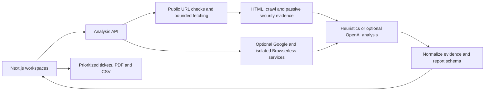

# PageSignal

**Turn website audit evidence into an actionable engineering backlog.**

PageSignal combines technical SEO, content analysis, Core Web Vitals, competitor comparison, and persona-led UX review in one workspace. Reports retain the supporting evidence and turn findings into prioritized tickets with acceptance criteria, CSV exports, and PDF reports.

This is an MVP for local evaluation and controlled deployments. It can run without paid API keys using deterministic heuristics; richer analysis is optional. Results are diagnostic recommendations, not proof of search ranking, accessibility compliance, security, or conversion improvement.

The public edition uses a light Magic UI design with accessible shadcn/Radix controls, persistent workspace navigation, subtle motion, and evidence-focused reports. The owner describes the project as independently developed from scratch as a side project; the interface was developed with AI assistance.

## What you can try

| Workspace | Purpose |
| --- | --- |
| Site analysis | Sample public pages, explain crawl failures, inspect SEO categories and passive security signals |
| Page analysis | Check a page against up to five target keywords and produce implementation tasks |
| Competitor comparison | Compare three URLs using a shared evidence model |
| UX audit | Assess a page through one primary and up to two secondary example or private saved personas; include screenshots only after verified consent handling |
| Feedback intelligence | Import or enter feedback, review deterministic classifications, and keep records in the current browser |

Reports support PDF, CSV, copied tables, and ticket text for GitHub, Jira, Linear, or Markdown. These are exports; direct issue-tracker synchronization is not implemented.

## Run locally

Use Node.js 22 and npm. From the repository directory:

```sh
npm ci
cp .env.example .env.local
npm run dev
```

Open [localhost:3000](http://localhost:3000). Choose **Try with a demo site** or visit [the UX workspace](http://localhost:3000/ux-audit).

The demo uses real public example domains. It requires internet access and can show missing evidence if a website or provider blocks fetching. There is no simulated offline report. Leave all credentials empty to use heuristic analysis. The public interface uses system fonts and needs no build-time font download.

## Optional integrations

Copy only your own values into `.env.local`. Never commit that file.

| Integration | Configuration | Without it |
| --- | --- | --- |
| Private saved personas | `SUPABASE_URL`, `SUPABASE_PUBLISHABLE_KEY`, `APP_URL` | Example personas remain available; see [setup](docs/PERSONAS_SETUP.md) |
| OpenAI | `OPENAI_API_KEY`, optional `OPENAI_MODEL` | Heuristic reports |
| Chrome UX Report | `GOOGLE_CRUX_API_KEY` | Field data marked unavailable |
| PageSpeed Insights | `GOOGLE_PAGESPEED_API_KEY`, optional `PAGESPEED_TIMEOUT_MS` | Lab data marked unavailable |
| Browserless | `SCREENSHOT_SERVICE_URL`, optional token and timeout | Structural UX analysis without verified screenshot evidence |
| Feedback delivery | `FEEDBACK_GAS_URL`, `FEEDBACK_GAS_TOKEN`, `FEEDBACK_RECIPIENT_EMAIL` | Delivery endpoint returns a clear unavailable response; manual feedback entry still works |
| Google Analytics | `NEXT_PUBLIC_GA_MEASUREMENT_ID` at build time | No GA script or event queue |

Existing `SEO_OPS_` aliases for AI, Google, and screenshot settings remain supported. See [.env.example](.env.example) for the complete list and feedback endpoint contract. Feedback credentials are server-side; the optional analytics ID is intentionally public. Operators must provide their own analytics consent and privacy arrangements before enabling it.

## How it works



Next.js App Router, React, JavaScript, Magic UI source components, shadcn/Radix controls, Motion and Tailwind CSS provide the UI. Material icons are retained as local SVGs; Material UI and Emotion are removed. See [third-party notices](THIRD_PARTY_NOTICES.md). The server uses the OpenAI SDK only when configured. Audit state lives in the current client session; ticket completion and the feedback library use browser local storage. Optional Supabase accounts store private custom personas in Postgres. Reports are not stored in a shared database.

Read the [architecture](docs/ARCHITECTURE.md), [engineering case study](docs/CASE_STUDY.md), [product detail](PRODUCT.md), and [roadmap](nextVersion.md). [init.md](init.md) is the project recreation prompt; [design-source.json](design-source.json) records the design contract. The UI was developed iteratively with AI assistance; the owner confirmed there is no Figma source.

## Validation

```sh
npm run check:public
npm run lint
npm test
npm run build
npm start
```

The start command serves the standalone build on `127.0.0.1:3000` by default. Use `PORT` to change the port; set `OPTISCAN_HOST` only when intentionally binding another interface.

GitHub Actions runs the public-file check, lint, tests, and production build without API secrets, plus the persona ownership SQL suite in a disposable PostgreSQL service. The public-file check detects selected credential patterns; it does **not** certify the absence of all secrets or inspect Git history. The test suite covers URL protections, bounded decompression, security evidence, consent handling, persona contracts, feedback classification, export safety, and optional integration defaults.

See the [dated release validation](docs/RELEASE_VALIDATION.md) for completed checks and their limits.

## Container deployment

```sh
docker build -t pagesignal .
docker run --rm -p 127.0.0.1:3000:3000 --env-file .env.local pagesignal
```

The container runs the standalone Next.js build as a non-root user. Analytics remains disabled in the default container build. Runtime environment changes do not alter a `NEXT_PUBLIC_` setting already embedded in the build.

The **Container** workflow is manual. Publishing is off by default and, when selected, targets the current repository's GHCR namespace. Review [SECURITY.md](SECURITY.md) before exposing a live service: global access controls, shared quotas, and isolated browser egress remain deployment requirements. Persona sign-in protects saved profiles; it does not protect every analysis endpoint.

## Contributing and reuse

See [CONTRIBUTING.md](CONTRIBUTING.md). Public visibility and permission to reuse are separate decisions. No open-source license has been selected for this preparation; the owner has confirmed code publication rights and the example personas/avatars have been replaced with original generic material. Third-party dependencies retain their own licenses. See [the release checklist](docs/PUBLIC_RELEASE.md).

Source repository: [Behzad85/page-signal](https://github.com/Behzad85/page-signal). The app header links here and retrieves the public star count on load and every five minutes while visible. No GitHub token is required; unavailable counts are shown honestly.
